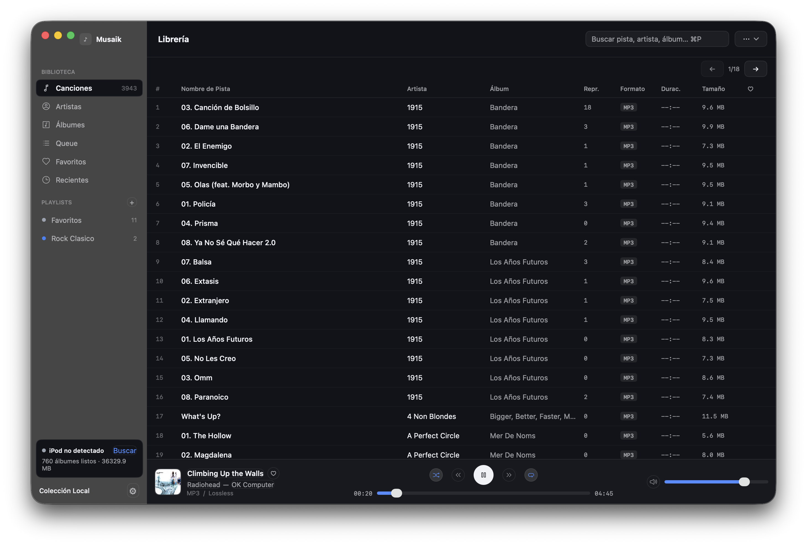
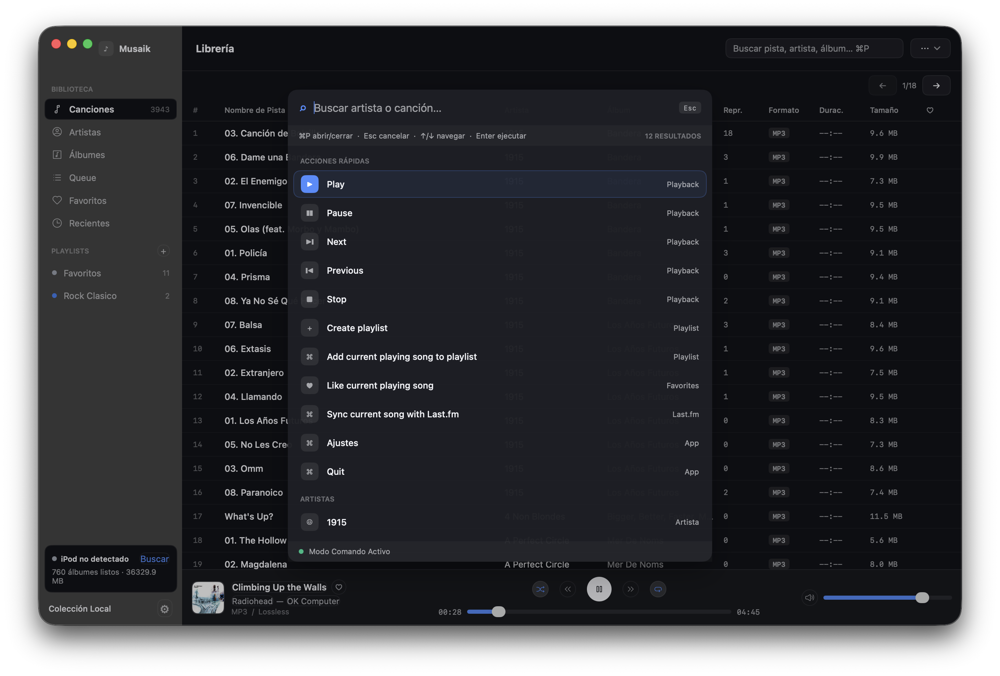
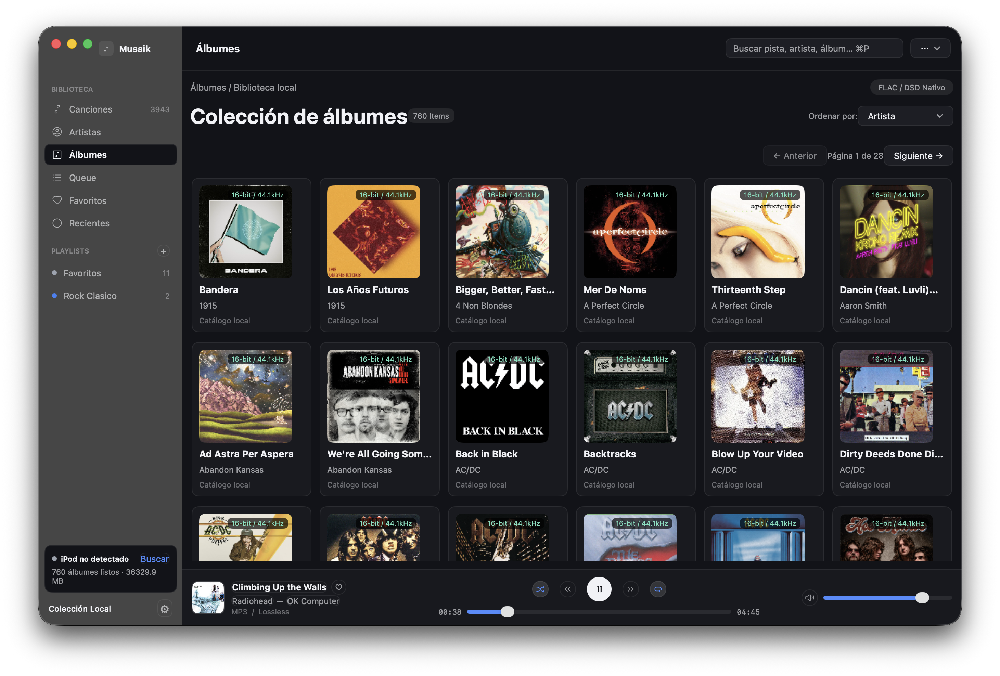
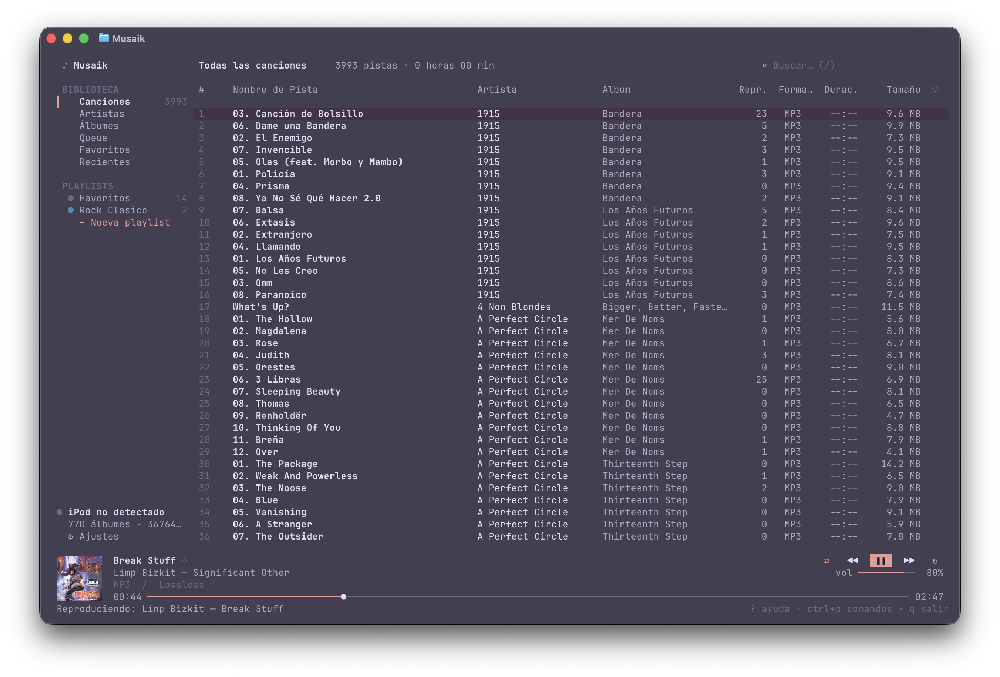
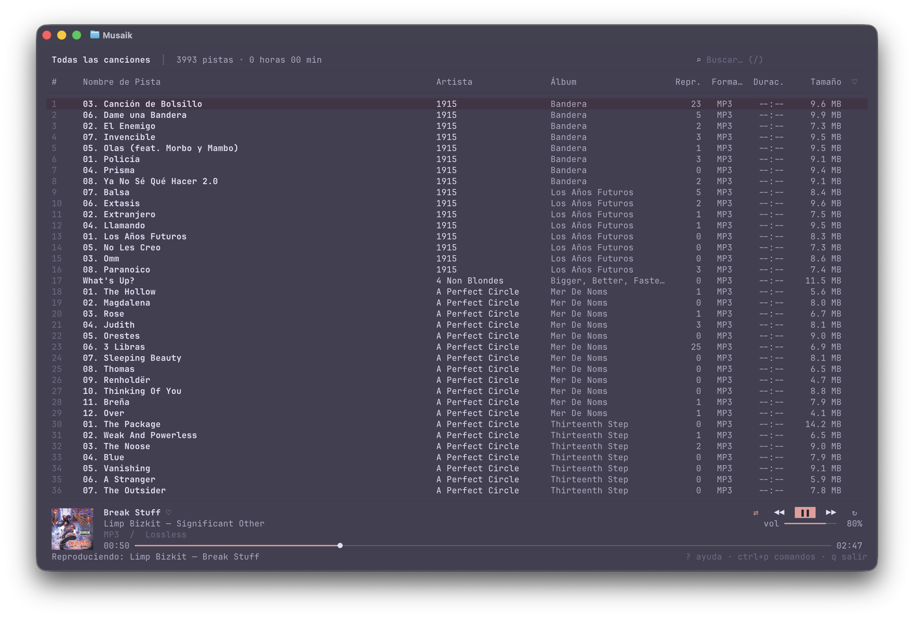
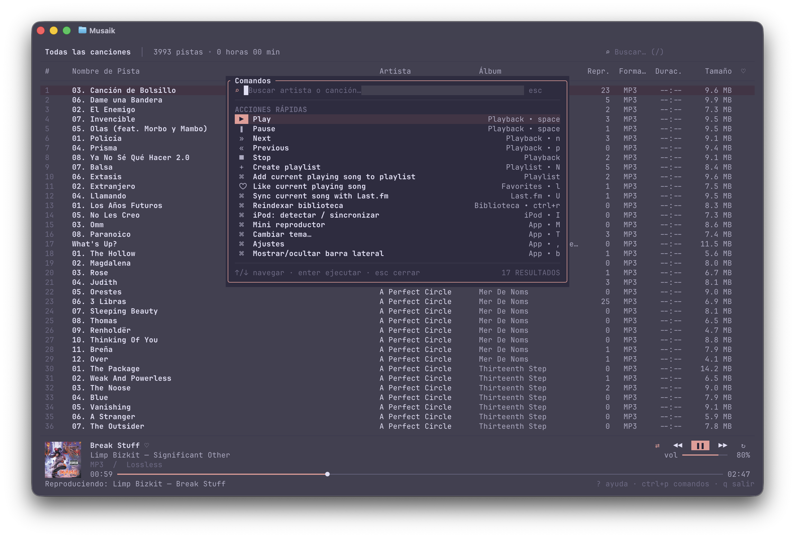

# Musaik

Musaik es un reproductor de música local escrito en Go. Tiene tres caras que comparten la misma biblioteca, playlists, likes y ajustes:

- **App de escritorio nativa para macOS** ([Mygo](https://github.com/egoist/mygo)): biblioteca, playlists, queue, mini reproductor flotante e integración con macOS.
- **Versión de terminal** (`musaik-tui`, Bubble Tea + Lip Gloss): la misma app en la terminal, con carátulas a resolución completa en kitty y Ghostty y 20 temas.
- **Extensión para Raycast / Tinycast**: controla Musaik desde el launcher.

## Screenshots
### Native UI





### CLI TUI





## Funcionalidades principales

- Biblioteca local con indexado recursivo para `mp3`, `mp4`, `flac`, `ogg`.
- Persistencia local, en `~/Library/Application Support/musaik/` (macOS):
  - `state.json`: canciones, favoritos, playlists, colores de playlist, playcount y última reproducción.
  - `settings.json`: sección activa, búsqueda, shuffle/repeat, barra lateral, control externo, opacidad del mini reproductor, Last.fm, iPod.
  - `tui.json`: preferencias propias de la versión de terminal (tema).
- Vistas:
  - **Canciones** (tabla con título, artista, álbum, plays, formato, duración, tamaño, like; las columnas secundarias se ocultan cuando la ventana se estrecha)
  - **Artistas** (listado y detalle por artista, con foto desde Last.fm)
  - **Álbumes** (grid + detalle, orden por artista, nombre o año)
  - **Queue** (canción actual + siguientes, relleno aleatorio)
  - **Favoritos** y **Recientes**
- Playlists:
  - crear/renombrar/eliminar playlists manuales, y playlists inteligentes (Favoritos)
  - agregar canción por menú contextual o drag & drop al sidebar
  - color por playlist (tag estilo Finder en sidebar)
- Reproductor:
  - play/pause/next/previous (con historial), shuffle, repeat (off/all/one), seek, volumen y mute
  - navegación contextual desde now-playing (título/caratula/artista/álbum)
  - barra adaptable: se reorganiza según el ancho de la ventana sin perder controles
  - botones con estados hover, pressed y activo
- **Mini reproductor**: ventana flotante siempre encima, con el fondo teñido por los colores de la carátula.
  Se abre con el botón de la barra del reproductor o `⇧⌘M`; oculta la ventana principal y un botón (o `⇧⌘M`, `⌘W`, `Esc`) vuelve a ella.
  La transparencia del fondo se ajusta en Ajustes → Apariencia.
- Barra lateral ocultable (`⌘B`).
- Last.fm:
  - auth automática desde ajustes
  - now playing, scrobble, `track.love`, sync de playcount/liked
- iPod Classic (modo disco):
  - detección en `/Volumes`
  - copia de audio, reescritura de la `iTunesDB` (con respaldo `iTunesDB.musaik.bak`) y exportación de playlist `.m3u8`
- Action Bar (`⌘P`): búsqueda de canciones, artistas y álbumes + acciones rápidas (reproducción, playlists, likes, Last.fm, ajustes, barra lateral, cerrar la app).
- Integración con macOS: Now Playing y teclas multimedia (`MPNowPlayingInfoCenter` / `MPRemoteCommandCenter`); `F7`/`F8`/`F9` solo como respaldo si esa integración falla.
- Control externo (opcional): API local para launchers, ver [Control externo y Raycast](#control-externo-y-raycast--tinycast).

### Atajos de la app de escritorio

| Atajo | Acción |
|---|---|
| `⌘P` | Action Bar |
| `⌘,` | Ajustes |
| `⌘B` | Mostrar/ocultar barra lateral |
| `⇧⌘M` | Mini reproductor (abrir/volver) |
| `Espacio` | Play/pausa (en el mini reproductor) |
| `⌘W` · `Esc` | Cerrar ajustes / volver desde el mini reproductor |

## Requisitos

- Go 1.27+
- Mygo CLI (se usa con `go tool mygo`)
- `ffplay` y `ffprobe`
- Para la versión de terminal: una terminal con color de 24 bits (y kitty ≥ 0.28 o Ghostty para las carátulas a resolución completa)
- Para la extensión: Node.js y npm

Orden de resolución para `ffplay/ffprobe`:

1. `PATH`
2. `MUSAIK_FFMPEG_DIR`
3. rutas embebidas/empacadas (`./bin`, `<ejecutable>/bin`, `Contents/Resources/bin` en macOS)

## Desarrollo

```bash
go mod tidy
go tool mygo dev        # app de escritorio
go run ./cmd/musaik-tui # versión de terminal
```

## Tests

```bash
go test ./...                              # todo
go test -race ./internal/core ./cmd/...    # motor y terminal, con detector de carreras
```

## Build

```bash
go tool mygo build                              # dist/darwin-arm64/Musaik.app y "Musaik <versión>.dmg"
go build -o dist/musaik-tui ./cmd/musaik-tui    # versión de terminal
(cd raycast && npm install && npm run build)    # extensión
```

La versión está en `mygo.json` y se sube con cada cambio; la versión de terminal la sigue (ver [`docs/TUI.md`](./docs/TUI.md) para inyectarla con `-ldflags`).

## Control externo y Raycast / Tinycast

Activa **Ajustes → Integraciones → Permitir control externo** (en la app) o el mismo ajuste en la versión de terminal.
Es opcional y viene apagado: no abre ningún puerto hasta que lo enciendes.

- Servidor HTTP solo en `127.0.0.1`, puerto `47821` (otro libre si está ocupado).
- Cada vez que arranca genera un token nuevo y lo publica con el puerto en `~/Library/Application Support/musaik/remote.json` (permisos `0600`). Exige `Authorization: Bearer <token>` y comprueba la cabecera `Host`, para que una página web no pueda controlar la app.
- Endpoints: `GET /state`, `GET /search?q=&limit=`, `GET /queue`, y `POST /toggle`, `/play`, `/pause`, `/next`, `/prev`, `/favorite`, `/volume?level=0-100`, `/play/{id}`, `/queue/{id}`.
- La app de escritorio y la de terminal hablan el mismo protocolo, así que la extensión funciona con las dos.

La extensión está en [`raycast/`](./raycast) y funciona en **Raycast** y en **Tinycast** (ambos ejecutan extensiones `@raycast/api`).
Comandos: Now Playing, Search Songs (`Enter` reproduce, `⌘↵` añade a la cola), Show Queue, Play / Pause, Next Track, Previous Track y Like Current Song.
Instalación y detalles en [`raycast/README.md`](./raycast/README.md).

## Versión de terminal (TUI)

`musaik-tui` es Musaik en la terminal, con la misma biblioteca, playlists, queue, likes, Last.fm, iPod y ajustes que la app de escritorio
(comparten `state.json` y `settings.json`).

```bash
go build -o dist/musaik-tui ./cmd/musaik-tui
./dist/musaik-tui                  # abre la biblioteca guardada
./dist/musaik-tui -root ~/Music    # indexa otra carpeta al arrancar
./dist/musaik-tui -mini            # arranca en modo mini
./dist/musaik-tui -images blocks   # fuerza las carátulas en bloques
```

- Todo desde el teclado, y también con el ratón (filas, barra de progreso, volumen, botones, rueda). `?` muestra todos los atajos; `ctrl+p` abre la paleta de comandos.
- **Carátulas a resolución completa** en kitty y Ghostty (protocolo gráfico de Kitty con *Unicode placeholders*); en cualquier otra terminal, en medio bloque.
- **20 temas** (`T`): Dracula, Catppuccin (Mocha, Macchiato, Frappé, Latte), Tokyo Night (Night, Storm, Day), Rosé Pine (con Moon y Dawn), Gruvbox, Nord, Solarized, One Dark, Kanagawa y los dos de Sonora (la paleta de la app de escritorio), más la opción «Automático», que sigue el fondo de la terminal.
- **Mini reproductor** (`M`): tarjeta compacta con los colores de la carátula.
- **Ligera**: ~0,4 % de un núcleo en reposo con 3600 canciones, y ~1 % mientras suena (sin contar `ffplay`).
- No porta lo que es de la ventana nativa: teclas multimedia y Now Playing de macOS, y el mini reproductor flotante.

Paridad de funciones, teclas, temas, carátulas y mediciones de rendimiento en [`docs/TUI.md`](./docs/TUI.md).

## Estructura del proyecto

```
main.go, miniplayer.go, playerbar.go, remote.go, nowplaying_darwin.go   app de escritorio (Mygo)
cmd/musaik-tui/        versión de terminal (Bubble Tea v2)
internal/core/         motor sin interfaz: reproducción, cola, likes, playlists, Last.fm, iPod, API remota
internal/library/      biblioteca y estado persistente
internal/player/       backend ffplay
internal/lastfm/       cliente Last.fm
internal/ipod/         sincronización con iPod (iTunesDB)
raycast/               extensión para Raycast / Tinycast
docs/                  operación y versión de terminal
```

`internal/core` es el motor de la versión de terminal. La app de escritorio todavía mantiene su propia copia de parte de esa lógica (paleta de la carátula, API remota); unificarlas es un pendiente.

## Memoria y profiling (RAM)

Musaik incluye instrumentación opcional para pprof y muestreo de memoria en la app de escritorio:

```bash
export MUSAIK_ENABLE_PPROF=1
export MUSAIK_PPROF_ADDR="127.0.0.1:6060"      # default: 127.0.0.1:6060
export MUSAIK_PROFILE_LOG="/tmp/musaik-mem.csv"
export MUSAIK_PROFILE_INTERVAL_MS=1000          # mínimo: 250
```

Con estas variables:

- expone `http://127.0.0.1:6060/debug/pprof/`
- escribe CSV por intervalo con:
  - `heap_alloc_mb`
  - `heap_sys_mb`
  - `rss_app_mb`
  - `rss_player_mb` (proceso `ffplay`)
  - `rss_total_mb` (app + backend)

La versión de terminal tiene su propio gancho: `MUSAIK_HEAP_PROFILE=/tmp/heap.prof` escribe un perfil de heap al recibir `SIGUSR1` (ver [`docs/TUI.md`](./docs/TUI.md#rendimiento)).

## Documentación del proyecto

- Especificación técnica: [`PROJECT-SPECS.md`](./PROJECT-SPECS.md)
- Roadmap y pendientes: [`todo.md`](./todo.md)
- Operación, debugging y guías: [`docs/OPERATIONS.md`](./docs/OPERATIONS.md)
- Versión de terminal: [`docs/TUI.md`](./docs/TUI.md)
- Extensión de Raycast / Tinycast: [`raycast/README.md`](./raycast/README.md)
